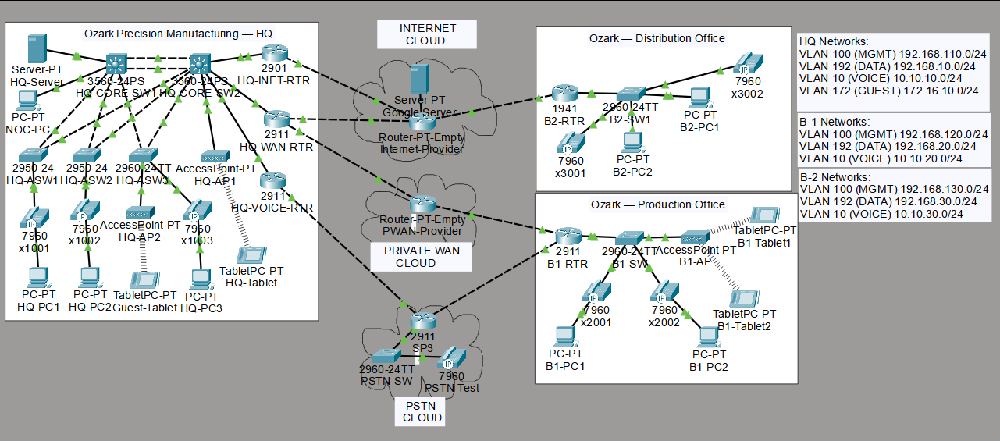

# Ozark Precision Manufacturing — Network Portfolio

A Cisco Packet Tracer lab for a fictional manufacturing company with three business locations.

**Portfolio owner:** Cody Phillips  
**Status:** Customization and testing in progress

## Project background

This project is adapted from a provided starter topology and configuration. My work focuses on personalizing the company scenario, reviewing the network, making configuration changes, and documenting test results.

## Network Topology

## Locations

- Headquarters
- Production Office — Branch 1
- Distribution Office — Branch 2

## Network scope

The lab covers business IT networking, including:

- Data, voice, management, and guest VLANs
- Inter-VLAN routing
- Redundant HQ core switches
- HSRP, spanning tree, and EtherChannel
- DHCP and wireless access
- Branch connectivity and simulated provider networks
- IP phones and access controls

Feature operation will be documented as testing is completed.

## Opening the lab

[Download the Packet Tracer lab](Ozark_Precision_Network.pkt)

## Planned additions

- Customized Packet Tracer project
- Network proposal and topology documentation
- Configuration change log
- Screenshots and test results

## Contact

Cody Phillips  
chphillips40@gmail.com

This is a fictional company portfolio lab. It does not represent a production deployment.
